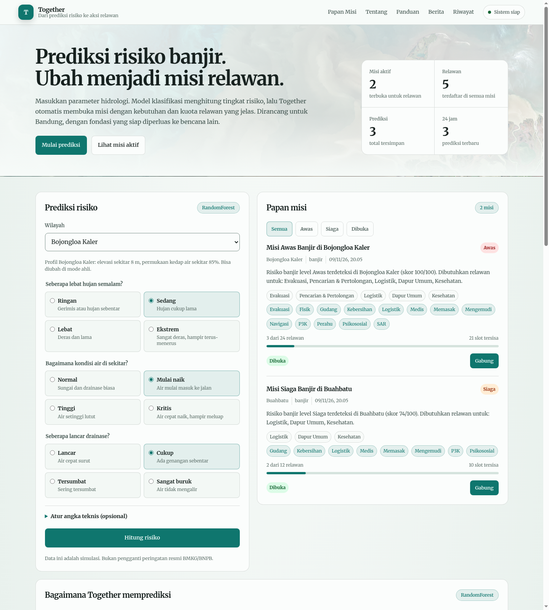
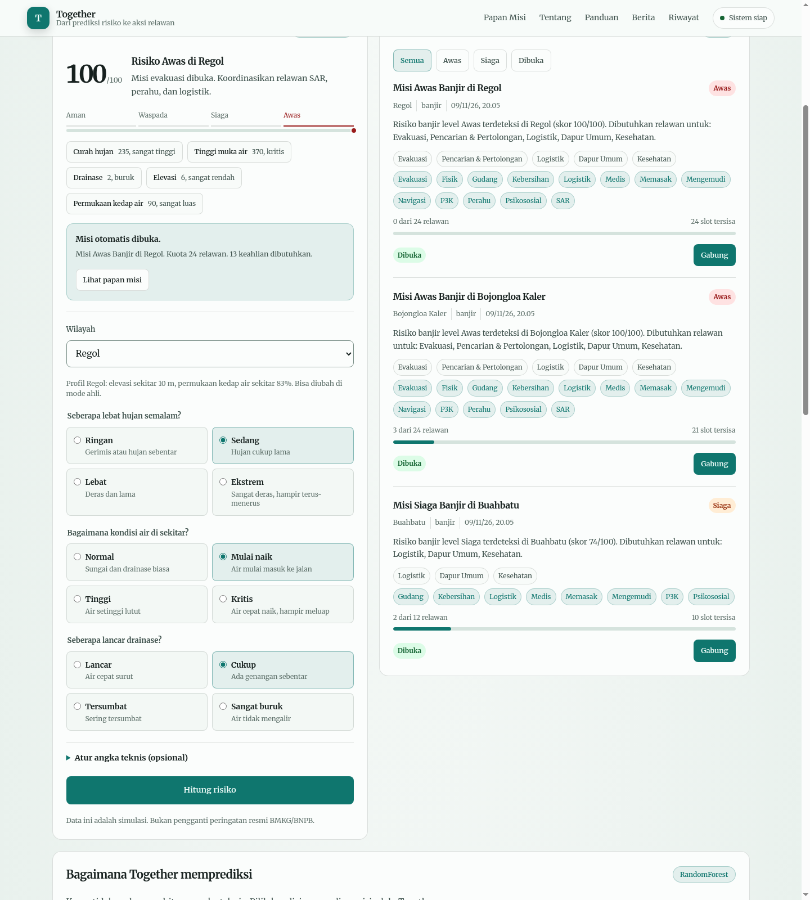
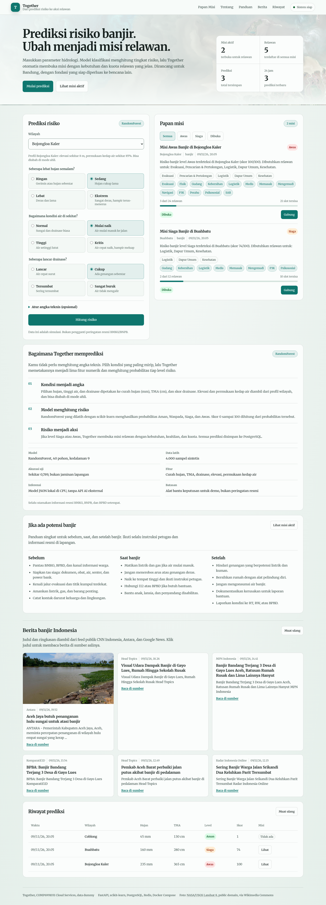
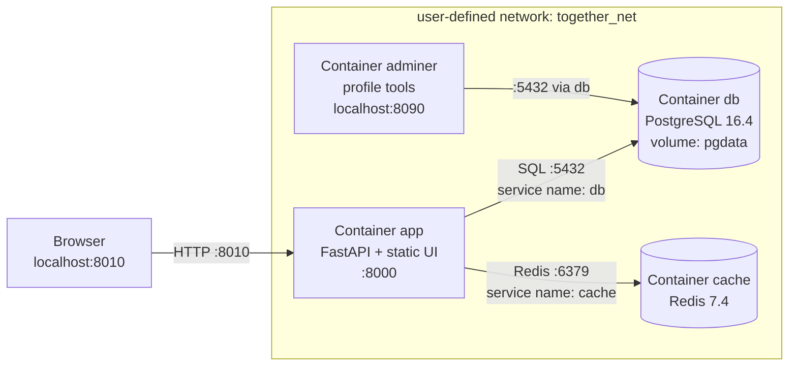

# Together — Dari Prediksi Risiko ke Aksi Relawan

Aplikasi web multi-tier yang mengubah **skor risiko banjir** menjadi **misi relawan yang terukur**. Model klasifikasi menghitung risiko dari parameter hidrologi; jika level mencapai **Siaga/Awas**, sistem otomatis membuka misi dengan kebutuhan, keahlian, dan kuota relawan. Relawan dapat bergabung sesuai keahlian, dan seluruh riwayat tersimpan di PostgreSQL.

> Proyek UTS COMP6991031 Cloud Services — LA75, BINUS Bandung.
> Kategori: **AI (Web + model ringan)**. Fokus penilaian: containerization, bukan banyaknya fitur.



*Screenshot dari `http://localhost:8010` setelah `docker compose up -d --build` (data demo).*



*Prediksi level Awas: skor 100/100, skala risiko empat level, faktor dominan, dan misi relawan yang otomatis dibuka.*



*Tampilan lengkap: prediksi, papan misi, penjelasan model, panduan siaga, berita banjir Indonesia, dan riwayat.*

---

## Tautan

- GitHub: <https://github.com/Syechran/together>
- Artikel: <https://medium.com/@akusyechran/together-ketika-prediksi-banjir-berubah-menjadi-misi-relawan-ec26094cef89?sharedUserId=akusyechran>
- Video: <https://youtu.be/t7GZCiZCUvM>

---

## 1. Masalah dan alasan proyek

Peringatan dini banjir sering berhenti pada informasi. Warga tahu ada risiko, tetapi tidak ada jalur cepat untuk mengubah informasi itu menjadi **tindakan**: siapa yang perlu dievakuasi, logistik apa yang kurang, relawan dengan keahlian apa yang dibutuhkan, dan berapa kuotanya.

**Together** mengisi celah itu dengan satu alur inti:

```
parameter hidrologi → prediksi risiko → misi otomatis → relawan bergabung
```

Target pengguna: warga dan relawan komunitas di Kota Bandung, serta koordinator posko yang perlu tahu kebutuhan dan kapasitas relawan dengan cepat.

### Profil singkat (bahan Soal 1a)

| Item | Isi |
|---|---|
| Nama proyek | Together |
| Kategori | AI (aplikasi web + model machine learning ringan) |
| Fitur inti (MVP) | Papan misi berbasis risiko: prediksi banjir otomatis membuka misi relawan |
| Konten pendukung | Berita banjir Indonesia, panduan siaga, dan penjelasan model |
| Masalah | Peringatan risiko tidak otomatis menjadi koordinasi relawan |
| Target pengguna | Warga, relawan komunitas, koordinator posko |
| Peran karier | Backend / Cloud-DevOps / ML Engineer |
| Model | RandomForest (scikit-learn) dilatih di tahap builder, diekspor ke JSON |
| Data pribadi | Nama, kontak dummy, keahlian relawan — dibahas dengan UU No. 27/2022 (PDP) |

**Karakteristik esensial NIST yang paling dibutuhkan:** *rapid elasticity* — trafik dan kebutuhan koordinasi melonjak saat bencana, lalu turun kembali. Arsitektur stateless (app + database + cache) memungkinkan penambahan replika aplikasi saat lonjakan.

**Biaya:** target Rp0 dengan free tier/localhost. Seluruh stack berjalan lokal; tidak ada layanan berbayar wajib.

**Kepatuhan:** hanya menyimpan data yang diperlukan (nama, kontak dummy, keahlian, wilayah). Kontak dimasking pada respons API. Tidak ada NIK, alamat rumah, atau nomor asli di data demo. Pada implementasi nyata: dasar pemrosesan, persetujuan, hak subjek data, dan retensi harus dijelaskan sesuai UU PDP.

---

## 2. Arsitektur



Alur request:

1. Browser membuka `http://localhost:8010`.
2. Static UI memanggil `POST /api/prediksi`.
3. FastAPI memuat model JSON dan menghitung level/skor.
4. Jika level `Siaga`/`Awas`, aplikasi menulis `prediksi` dan `misi` ke PostgreSQL.
5. `GET /api/misi` membaca papan misi; hasilnya di-cache di Redis selama 10 detik.
6. `POST /api/misi/{id}/gabung` menulis `partisipasi`, memvalidasi keahlian/kuota, lalu menghapus cache.
7. `GET /api/berita` mengambil RSS publik CNN Indonesia, Antara, dan Google News, memfilter berita banjir Indonesia, lalu menyimpannya di cache Redis selama 15 menit. Gambar dipakai bila feed menyediakannya.

**Mengapa container, bukan VM?** Container berbagi kernel host sehingga jauh lebih ringan: isolasi proses lewat **namespaces** (PID, network, mount), pembatasan resource lewat **cgroups**, ukuran image jauh lebih kecil daripada VM, dan waktu startup hitungan detik (bahkan kurang) dibanding boot OS penuh. Untuk aplikasi satu fitur seperti ini, VM menambah overhead OS yang tidak memberi nilai tambah.

---

## 3. Cara menjalankan

Prasyarat: Docker Engine + Docker Compose v2.

```bash
git clone https://github.com/Syechran/together.git
cd together
cp .env.example .env
docker compose up -d --build
```

Buka:

- Aplikasi: <http://localhost:8010>
- Health check: <http://localhost:8010/health>
- Adminer (opsional, profil `tools`): <http://localhost:8090>
  - System: `PostgreSQL`
  - Server: `db`
  - Username/password/database: sesuai `.env`

Hentikan:

```bash
docker compose down          # container berhenti, volume pgdata TETAP ada
docker compose down -v       # container + volume dihapus, data hilang
```

`docker compose down -v` menghapus named volume `pgdata`, sehingga data benar-benar hilang. Ini berbeda dengan `down` biasa yang hanya menghapus container dan network.

### Profil tools (Adminer)

```bash
docker compose --profile tools up -d
```

Atau:

```bash
docker compose up -d
docker compose --profile tools up -d adminer
```

---

## 4. Endpoint

| Method | Path | Status sukses | Fungsi |
|---|---|---|---|
| GET | `/health` | 200 | Cek database, cache, dan model |
| POST | `/api/prediksi` | 201 | Hitung risiko + buat misi bila melewati ambang |
| GET | `/api/prediksi` | 200 | Riwayat prediksi terbaru |
| GET | `/api/misi` | 200 | Papan misi (cached 10 detik di Redis) |
| GET | `/api/misi/{id}` | 200 | Detail misi + relawan terdaftar |
| POST | `/api/misi/{id}/gabung` | 201 | Daftarkan relawan sesuai keahlian |
| GET | `/api/statistik` | 200 | Ringkasan dashboard |
| GET | `/api/berita` | 200 | Berita banjir Indonesia dari RSS publik (cache 15 menit) |

> Swagger/OpenAPI (`/docs`, `/redoc`, `/openapi.json`) dinonaktifkan pada build ini. Endpoint diuji dengan curl/Postman.

Contoh:

```bash
# 1. Prediksi risiko tinggi -> misi otomatis dibuat
curl -i -X POST http://localhost:8010/api/prediksi \
  -H 'Content-Type: application/json' \
  -d '{"wilayah":"Bojongloa Kaler","curah_hujan_mm":235,"tma_cm":365,"drainase_skor":2,"elevasi_m":6,"impervious_pct":88}'

# 2. Lihat papan misi
curl -i http://localhost:8010/api/misi

# 3. Gabung misi (keahlian harus cocok)
curl -i -X POST http://localhost:8010/api/misi/1/gabung \
  -H 'Content-Type: application/json' \
  -d '{"nama":"Relawan Dummy","kontak":"0812-DUMMY-010","keahlian":["Logistik","Mengemudi"]}'
```

Status error yang disengaja:

- `404` — misi tidak ditemukan.
- `409` — kuota penuh, misi ditutup, kontak duplikat, atau keahlian tidak cocok.
- `422` — validasi body (mis. `curah_hujan_mm` di luar 0–500).
- `503` — `/health` mendeteksi database/cache/model bermasalah.

Uji cepat:

```bash
make test
# atau
bash tests/smoke.sh
```

---

## 5. Machine learning

- **Algoritma:** RandomForestClassifier (`scikit-learn==1.5.2`).
- **Fitur:** `curah_hujan_mm`, `tma_cm`, `drainase_skor`, `elevasi_m`, `impervious_pct`.
- **Label:** `Aman`, `Waspada`, `Siaga`, `Awas`.
- **Data:** 4.000 sampel sintetis dengan fungsi risiko + noise. Akurasi bukan tujuan utama; tujuannya pipeline ML yang nyata dan dapat dijelaskan.
- **Hasil build terakhir:** akurasi uji **0,7887**, 40 pohon, kedalaman 9, ukuran model JSON **±580 KiB**, selisih inferensi JSON vs scikit-learn **9,25e-10**.
- **Ekspor:** pohon keputusan diekspor ke `model/model.json`. Runtime **tidak** menginstal scikit-learn/scipy/numpy; inferensi dilakukan dengan traversal pohon murni Python di `app/risk.py`.
- **Mengapa:** ini memperkecil image runtime dari ±718 MB menjadi ±314 MB, sekaligus memperjelas manfaat multi-stage build. Model tetap dilatih dengan scikit-learn di builder; yang berubah hanya cara mengemas inferensi.

Latih ulang di lokal (butuh dependensi ML):

```bash
python -m venv .venv
source .venv/bin/activate
pip install -r requirements-ml.txt
python ml/train_model.py --output model
```

---

## 6. Penjelasan Dockerfile (baris penting)

```dockerfile
# syntax=docker/dockerfile:1.7
FROM python:3.12.7-slim-bookworm AS builder
```

- `# syntax` memilih frontend BuildKit agar fitur Dockerfile modern tersedia.
- `python:3.12.7-slim-bookworm` adalah base image dengan **tag versi spesifik** (bukan `latest`), sehingga build reproducible.

```dockerfile
WORKDIR /build
COPY requirements.txt requirements-ml.txt ./
RUN python -m venv /opt/mlvenv \
    && /opt/mlvenv/bin/pip install --upgrade pip==24.2 \
    && /opt/mlvenv/bin/pip install -r requirements-ml.txt
```

- `WORKDIR` menetapkan direktori kerja.
- **Dependency disalin sebelum source code**: layer `pip install` hanya dibangun ulang jika file requirements berubah. Source code yang berubah tidak membatalkan cache dependency.
- Builder memakai virtualenv terpisah (`/opt/mlvenv`) berisi scikit-learn, numpy, dan dependensi produksi. Venv ini **tidak** dikirim ke runtime.

```dockerfile
COPY ml/ ./ml/
RUN /opt/mlvenv/bin/python ml/train_model.py --output /build/model
```

- Training dilakukan saat build, bukan saat container start. Hasilnya `model.json` + `model_meta.json`.

```dockerfile
FROM python:3.12.7-slim-bookworm AS runtime
ENV PYTHONDONTWRITEBYTECODE=1 \
    PYTHONUNBUFFERED=1 \
    PATH="/opt/venv/bin:$PATH" \
    MODEL_PATH=/app/model/model.json
WORKDIR /app
RUN addgroup --system app && adduser --system --ingroup app app
```

- Tahap runtime dimulai dari base image bersih. Ini inti **multi-stage**: toolchain ML, cache pip, dan training script tidak ikut.
- `ENV` menetapkan env aplikasi; `PYTHONUNBUFFERED=1` membuat log langsung keluar.
- Container berjalan sebagai user non-root `app` (praktik keamanan).

```dockerfile
COPY requirements.txt ./
RUN python -m venv /opt/venv \
    && /opt/venv/bin/pip install --upgrade pip==24.2 \
    && /opt/venv/bin/pip install -r requirements.txt \
    && rm -rf /root/.cache/pip
COPY --from=builder /build/model /app/model
COPY app/ ./app/
```

- Runtime hanya menginstal dependensi produksi.
- `COPY --from=builder` mengambil **hanya artefak model**, bukan seluruh venv builder.
- `COPY` dipakai, bukan `ADD`, karena `ADD` punya perilaku tambahan (auto-extract archive, remote URL) yang tidak kita butuhkan dan lebih sulit diaudit.

```dockerfile
EXPOSE 8000
HEALTHCHECK --interval=30s --timeout=5s --start-period=20s --retries=3 \
    CMD ["python", "-c", "import urllib.request; urllib.request.urlopen('http://127.0.0.1:8000/health')"]
CMD ["uvicorn", "app.main:app", "--host", "0.0.0.0", "--port", "8000", "--proxy-headers"]
```

- `EXPOSE` mendokumentasikan port internal (pemetaan ke host ada di Compose).
- `HEALTHCHECK` memakai Python standar, tidak perlu `curl`.
- `CMD` dalam **exec form** (array JSON), sehingga proses langsung dijalankan tanpa shell perantara dan sinyal berhenti diteruskan dengan benar.

### Ukuran image

```bash
docker images together-app:1.0.0
# REPOSITORY        TAG       IMAGE ID       CREATED         SIZE
# together-app     1.0.0     ...            ...             314MB
```

Tanpa multi-stage, scikit-learn + scipy + numpy + cache pip + training script akan ikut ke runtime (percobaan awal: ±718 MB). Dengan memisahkan builder dan runtime, image turun menjadi **±314 MB**; model yang dikirim hanya **±580 KiB** JSON.

### `.dockerignore`

`.dockerignore` mengecualikan `.git`, `.env`, `model`, `tests`, `docs`, `screenshots`, dan cache Python. Dampaknya: build context lebih kecil, `.env` tidak pernah masuk image, dan layer cache tidak tercemar file yang tidak relevan.

---

## 7. Penjelasan docker-compose.yml

```yaml
name: together
```

- Nama project Compose; memengaruhi nama network/volume (`together_net`, `together_pgdata`).

```yaml
services:
  db:
    image: postgres:16.4-alpine
    environment:
      POSTGRES_USER: ${POSTGRES_USER}
      POSTGRES_PASSWORD: ${POSTGRES_PASSWORD}
      POSTGRES_DB: ${POSTGRES_DB}
    volumes:
      - pgdata:/var/lib/postgresql/data
    networks:
      - together_net
    healthcheck:
      test: ["CMD-SHELL", "pg_isready -U ${POSTGRES_USER} -d ${POSTGRES_DB}"]
```

- Service `db` memakai PostgreSQL dengan tag spesifik.
- **Named volume** `pgdata` menyimpan data di luar lifecycle container. Container boleh dihapus, data tetap ada.
- `healthcheck` memastikan PostgreSQL benar-benar siap menerima koneksi, bukan hanya “container running”.

```yaml
  cache:
    image: redis:7.4-alpine
    command: ["redis-server", "--save", "", "--appendonly", "no"]
    healthcheck:
      test: ["CMD", "redis-cli", "ping"]
```

- Redis dipakai nyata oleh `GET /api/misi` (cache 10 detik) dan diinvalidasi saat ada prediksi/gabung.
- `healthcheck` `redis-cli ping` memenuhi syarat bonus cache.

```yaml
  app:
    build:
      context: .
      dockerfile: Dockerfile
    image: together-app:1.0.0
    env_file:
      - .env
    environment:
      DATABASE_URL: postgresql+psycopg://${POSTGRES_USER}:${POSTGRES_PASSWORD}@db:5432/${POSTGRES_DB}
      REDIS_URL: redis://cache:6379/0
    ports:
      - "${APP_PORT:-8010}:8000"
    depends_on:
      db:
        condition: service_healthy
      cache:
        condition: service_healthy
```

- `env_file` membaca konfigurasi dari `.env` (yang **tidak** di-commit).
- Host database adalah **nama service** `db`, bukan `localhost`/IP. Di dalam network Compose, DNS internal menyelesaikan `db` dan `cache`.
- `depends_on` dengan `condition: service_healthy` menunda start aplikasi sampai database dan cache lolos healthcheck.
- Port host dapat diubah lewat `APP_PORT` (default 8010 karena 8000 dipakai proses lain di mesin pengembang).

```yaml
  adminer:
    image: adminer:4.8.1
    profiles: ["tools"]
    environment:
      ADMINER_DEFAULT_SERVER: db
    ports:
      - "${ADMINER_PORT:-8090}:8080"
```

- Adminer hanya berjalan jika profil `tools` diaktifkan: `docker compose --profile tools up -d`.
- Ini memenuhi syarat **satu profile** pada soal.

```yaml
networks:
  together_net:
    driver: bridge

volumes:
  pgdata:
```

- User-defined bridge network mengisolasi stack dari network lain.
- `pgdata` adalah named volume untuk database.

---

## 8. Bukti demo dan persistensi

Perintah lengkap dan hasil nyata ada di catatan lokal `docs/bukti-demo.md` (tidak di-commit). Ringkasnya:

```bash
docker compose ps
# app, db, cache healthy; adminer (jika profil tools aktif)

curl -i http://localhost:8010/health
# HTTP/1.1 200 OK
# {"status":"ok","checks":{"database":"ok","cache":"ok","model":"ok"}}

curl -i -X POST http://localhost:8010/api/prediksi ...
# HTTP/1.1 201 Created

curl -i -X POST http://localhost:8010/api/misi/1/gabung ...
# HTTP/1.1 201 Created

docker compose down
docker compose up -d
# data prediksi/misi/partisipasi tetap ada karena volume pgdata tidak dihapus
```

Untuk screenshot (wajib diambil sendiri, jangan palsu):

1. `docker compose ps` — semua service `Up`, db/cache `healthy`.
2. `curl -i` endpoint prediksi — terlihat `HTTP/1.1 201`.
3. `curl -i` endpoint gabung — terlihat `HTTP/1.1 201`.
4. Dashboard `http://localhost:8010` — form, hasil prediksi, papan misi.
5. Sebelum/sesudah `docker compose down` lalu `up -d` — jumlah data sama.

### Catatan desain

- Tema **light cool paper** dengan aksen teal, bukan cream/terracotta dan bukan dark dashboard.
- Font **Merriweather** di-host sendiri di `app/static/fonts/` (SIL OFL 1.1); semua teks memakai serif yang sama.
- Hero memakai citra satelit delta Mackenzie (NASA/USGS Landsat 8, public domain) dengan scrim terang dan fade ke `--bg`; panel tetap solid. Kredit ada di footer dan `app/static/images/CREDITS.md`.
- Papan misi memakai baris berhairline, bukan kartu di dalam kartu. Berita memakai kartu di luar panel agar hierarki tetap jelas.
- Form prediksi memakai pilihan bahasa manusia (ringan/sedang/lebat, normal/naik/tinggi, dan seterusnya); angka teknis tetap tersedia di mode ahli.
- Warna level (`Aman`, `Waspada`, `Siaga`, `Awas`) dipakai secara semantik pada badge, skala risiko, dan status, bukan sebagai dekorasi.
- Skor risiko ditampilkan sebagai angka + skala empat level, bukan progress ring dekoratif.
- Hallmark check stamp ada di baris pertama `app/static/styles.css`. Lint statis dan render: **0 FAIL, 0 REFLEX, 0 WARN**.
- Referensi visual disimpan lokal di `docs/reference/themes/` (tidak di-commit), dibuat dari screenshot aplikasi sendiri, bukan foto stok.
- Kontras teks, ukuran font fungsional, focus ring, state aktif/disabled, dan `prefers-reduced-motion` sudah diperiksa.

### Bonus yang sudah tersedia

- **Redis cache:** service `cache` dengan healthcheck, dipakai `GET /api/misi` (TTL 10 detik) dan diinvalidasi saat ada perubahan. (+5)
- **Docker Hub (opsional, langkah manual):**

```bash
docker login
docker tag together-app:1.0.0 <DOCKERHUB_USER>/together:1.0.0
docker tag together-app:1.0.0 <DOCKERHUB_USER>/together:latest
docker push <DOCKERHUB_USER>/together:1.0.0
docker push <DOCKERHUB_USER>/together:latest
```

- **Supabase:** tidak diimplementasikan pada MVP ini agar scope tetap satu fitur. Jika waktu tersisa, integrasi yang paling relevan adalah Auth untuk koordinator posko; kredensial tetap di `.env`.

---

## 9. Struktur proyek

```text
together/
├── app/
│   ├── main.py          # route FastAPI, health, startup
│   ├── config.py        # env
│   ├── db.py            # engine, session, create_all
│   ├── models.py        # prediksi, misi, partisipasi
│   ├── schemas.py       # validasi Pydantic
│   ├── risk.py          # inferensi JSON pohon + faktor/rekomendasi
│   ├── missions.py      # aturan kebutuhan/keahlian/kuota
│   ├── serializers.py   # bentuk respons + masking kontak
│   ├── cache.py         # Redis
│   ├── news.py          # RSS berita banjir Indonesia
│   ├── seed.py          # data demo
│   └── static/          # UI (HTML/CSS/JS, tanpa build step)
├── ml/train_model.py    # training + ekspor model.json
├── tests/smoke.sh       # smoke test endpoint
├── docs/                # lokal, di-ignore (draft laporan dan referensi)
├── Dockerfile
├── docker-compose.yml
├── .env.example
├── requirements.txt
├── requirements-ml.txt
└── README.md
```

### Dokumen lokal

Draft Soal 1, artikel, video, checklist pengumpulan, dan referensi desain disimpan lokal di `docs/` dan **tidak di-commit** ke repo publik. File tersebut tetap tersedia di mesin pengembang untuk menyusun PDF.

---

## 10. AI Usage Declaration

> **Penting:** sesuaikan dengan kenyataan dan pastikan kamu dapat menjelaskan setiap baris Dockerfile/compose. Jangan mengklaim lebih dari porsi bantuan yang sebenarnya.

- **Alat yang dipakai:** Kilo Code (model `deepseek-flash`), **Impeccable** (design review/detector), dan **Hallmark** (design skill/gate checker).
- **Bagian yang dibantu:** brainstorming ide dan diferensiasi, scaffolding struktur proyek, implementasi awal FastAPI/SQLAlchemy/Redis, UI dashboard, audit desain, debugging error runtime, draf README/artikel/script video.
- **Contoh prompt utama:** “Buat aplikasi multi-tier FastAPI + PostgreSQL + Redis dengan satu alur prediksi risiko banjir → misi relawan → gabung, Docker multi-stage, healthcheck, named volume, dan profil Adminer.”
- **Perkiraan porsi bantuan AI:** isi sesuai kenyataan (maksimal 50% sesuai tipe Partial).
- **Pernyataan:** saya memahami dan dapat menjelaskan setiap baris Dockerfile dan `docker-compose.yml`.

---

## 11. Pernyataan orisinalitas

Saya menyatakan bahwa kode, artikel, dan video proyek ini dikerjakan sendiri selama periode UTS, menggunakan library open-source dan dokumentasi resmi yang disebutkan di bawah. Saya tidak menyalin karya orang lain tanpa atribusi dan tidak menggunakan data pribadi nyata.

---

## 12. Sumber dan atribusi

- FastAPI — <https://fastapi.tiangolo.com/>
- SQLAlchemy — <https://www.sqlalchemy.org/>
- scikit-learn — <https://scikit-learn.org/>
- PostgreSQL — <https://www.postgresql.org/>
- Redis — <https://redis.io/>
- Adminer — <https://www.adminer.org/>
- Merriweather (SIL OFL 1.1) — `app/static/fonts/merriweather-var.woff2`, lisensi di `app/static/fonts/OFL.txt`.
- *Mackenzie River Outflow*, Operational Land Imager on Landsat 8, NASA/USGS, public domain — hero background; sumber di `app/static/images/CREDITS.md`.
- Berita: RSS publik CNN Indonesia, Antara, dan Google News. Judul, ringkasan, dan gambar tetap milik sumber aslinya; setiap kartu menautkan ke artikel asli.
- Impeccable design skill (Apache 2.0) — dipakai untuk audit tampilan; bukan dependency runtime.
- Hallmark design skill (MIT) — dipakai untuk audit/gate desain; bukan dependency runtime.
- Base image resmi Docker Hub: `python:3.12.7-slim-bookworm`, `postgres:16.4-alpine`, `redis:7.4-alpine`, `adminer:4.8.1`.
- Referensi domain (bukan kode): riset API NASA FIRMS/AccuWeather dan konsep risk engine dari proyek SiagaApi; digunakan sebagai konteks masalah, bukan copy-paste kode.

---

## 13. Roadmap (di luar scope UTS)

- Longsor sebagai model kedua (fitur hujan + kemiringan + jenis tanah).
- Karhutla (hotspot/angin/kelembapan) sebagai plugin risk engine.
- Umpan balik laporan relawan ke model (human-in-the-loop).
- Autentikasi koordinator dan audit log.
- Notifikasi WhatsApp/email (tetap dengan data minimal).

---

## 14. Checklist pengumpulan

- [ ] Repo GitHub Public dibuat **selama periode ujian**, minimal 5 commit bertahap.
- [ ] README ini sudah berisi tautan artikel & video yang asli.
- [ ] Artikel publik 500–800 kata (Medium/dev.to/Hashnode/LinkedIn/blog).
- [ ] Video YouTube Public 3–5 menit, suara sendiri, menampilkan Dockerfile/compose dan uji persistensi.
- [ ] PDF `UTS_COMP6991031_NIM_Nama.pdf` berisi identitas, judul, tiga tautan, jawaban Soal 1 & 2 + screenshot, AI Declaration, pernyataan orisinalitas.
- [ ] `.env` tidak pernah ter-commit; `.env.example` tersedia.
- [ ] Semua tautan bisa dibuka tanpa login.
- [ ] Tidak ada NIK/alamat/nomor telepon asli di repo, screenshot, atau video.
